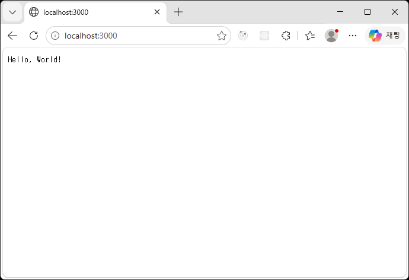

# rust-hello

---

- IDE: RustRover
- rust: 1.99.0   
- cargo: 1.99.0

### 프로젝트 생성

---
```
cargo new rust-hello
```

### 실행 방법

---
- rust 설치 후, `cargo`를 통해 실행
```
cargo run
```

- rust도 C언어와 마찬가지로 `fn main()` 함수가 Entry Point역할을 합니다.

- 빌드 및 컴파일 상태 확인
```
cargo build
cargo build --release
cargo check
```

빌드 결과물은 `target/debug` 또는 `target/release` 폴더를 확인

### Axum

---
https://crates.io/crates/axum   
https://tokio.rs/
1. 프로젝트 의존성 추가(axum, tokio)
---
```
cargo add axum
cargo add tokio
```
axum은 tokio 런타임 위에서만 동작하도록 설계된 프레임워크 입니다.

- Cargo.toml
```toml
[package]
name = "rust-hello"
version = "0.1.0"
edition = "2024"

[dependencies]
axum = "0.8.9"
tokio = "1.53.2"
```
Cargo.toml에서 tokio 는 features를 full로 설정

```toml
tokio = { version = "1.53.2", features = ["full"] }
```
`features = ["full"]` 은 Tokio의 모든 기능을 활성화

2. main.rs에 간단한 get 라우트 작성
```rust
use axum::{
    routing::{get, },
    Router,
    response::IntoResponse
};

#[tokio::main]
async fn main() {
    println!("Hello, world!");
    
    async fn callback() -> impl IntoResponse {
        "Hello, World!"
    }

    let app = Router::new().route("/", get(callback));
    let listener = tokio::net::TcpListener::bind("0.0.0.0:3000").await.unwrap();
    axum::serve(listener, app).await.unwrap();
}
```
Axum에서는 요청에 일치하는 경로를 정의하는 기능인 라우팅을 `Router`를 통해서 구현   
Router 인스턴스를 생성하고 route() 메서드에 연결할 주소와 사용할 HTTP 메서드를 의미하는 함수(핸들러)를 인자로 전달   
현재 코드는 콜백 함수를 따로 작성했는데, ||(파이프 기호)를 사용한 클로저 형태로도 작성이 가능합니다.   
`let app = Router::new().route("/", get(|| async { "Hello, World!" }));`

3. `cargo run`을 통해 확인


4. 코드 설명
- 모듈 및 크레이트 가져오기(`use` 문법)
{}를 사용하면 같은 경로에 있는 여러 아이템을 한 번에 묶어서 가져올 수 있습니다.
- #[tokio::main] 비동기 런타임 진입점 설정   
러스트는 기본적으로 비동기 함수를 만들 수 없습니다.(비동기 런타임 API를 제공하지 않음) 그래서 tokio같은 외부 라이브러리를 사용하고 속성 매크로를 붙여 main()를 비동기 함수로 변환
- Router::new() 구조체의 인스턴스 생성
- tokio::net:TcpListener 외부 크레이트인 tokio가 제공하는 네트워크 소켓 모듈에서 TCP 리스너 구조체를 가져와 사용
- axum::serve 준비한 리스너와 라우팅 규칙을 결합하여 실제 웹 서버를 구동하는 함수
- unwrap() 함수는 에러가 발생할 수 있는 값(Result, Option)을 다룰 때 성공하거나 값이 있을테니 바로 꺼내줘라는 러스트 문법입니다. 실패하면 그냥 강제종료 시킵니다.

```
fn main() {
    let fruits = vec!["사과", "바나나", "포도"];

    // 0번째 인덱스의 값을 확신하고 unwrap으로 꺼내기
    let first_fruit = fruits.get(0).unwrap();
    println!("첫 번째 과일: {}", first_fruit); // 출력: 사과

    // 🚨 [주의] 범위를 벗어난 인덱스를 unwrap하면 프로그램이 강제 종료됩니다.
    // let broken = fruits.get(10).unwrap(); // 💥 인덱스 10은 없으므로 크래시!
}
```

### docs

---
[Rust 모듈](docs/module.md)